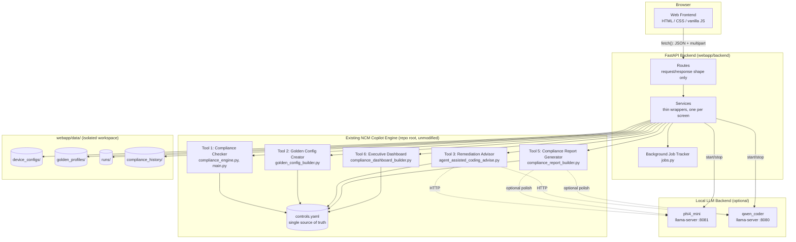
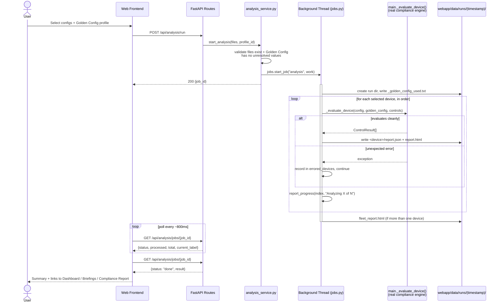
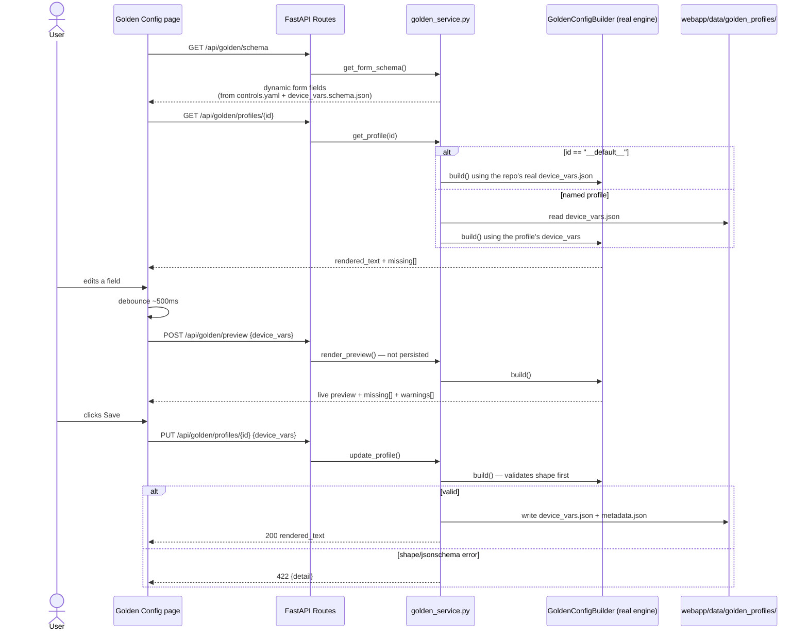
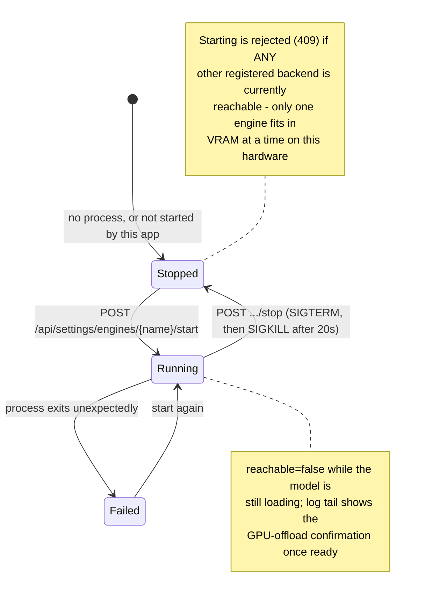
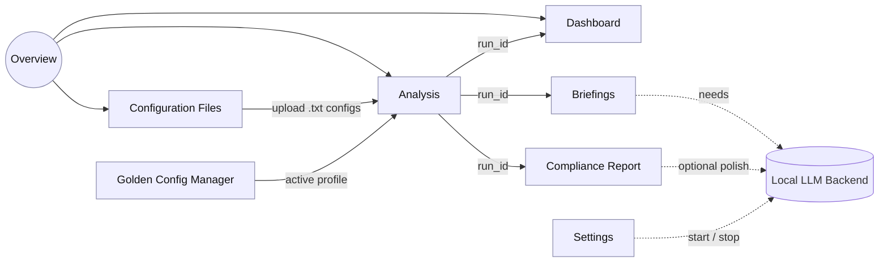

# NCM Copilot — Architecture Diagrams

Mermaid diagrams explaining how the application fits together: the web
frontend, its FastAPI backend, the six existing CLI tools it orchestrates,
the local LLM backend, and the isolated data workspace. These render
natively in GitHub and in VS Code's Markdown preview — no extra tooling
needed. See `documentation/WEBAPP.md` for the prose version of the same
architecture plus the full API reference.

## 1. System overview

Everything under "Existing NCM Copilot Engine" is unmodified, real project
code — the web frontend is a thin orchestration layer on top of it, never a
reimplementation.

## 2. Analysis run — end to end

The core user journey: pick configs and a Golden Config, run the real
compliance engine, and land on the downstream screens. One device's
unexpected failure is isolated and never aborts the batch.

## 3. Golden Config Manager — edit, preview, save

"Default" is never stored — it's rendered on demand from the repo's real
`controls.yaml` + `device_vars.json`, so it can never drift from what
`golden_config_main.py` would produce. Live preview calls a non-persisting
endpoint so editing never silently saves.

## 4. Local LLM engine lifecycle

Added so Briefings and Compliance Report polishing can be turned on/off from
the Settings screen instead of a terminal. "Running" means the OS process is
alive — `reachable` (the Online badge) only flips true once the model has
finished loading.

## 5. Screen map

How the eight screens connect. Dotted lines mean "needs the LLM backend
reachable"; everything else works without it.

