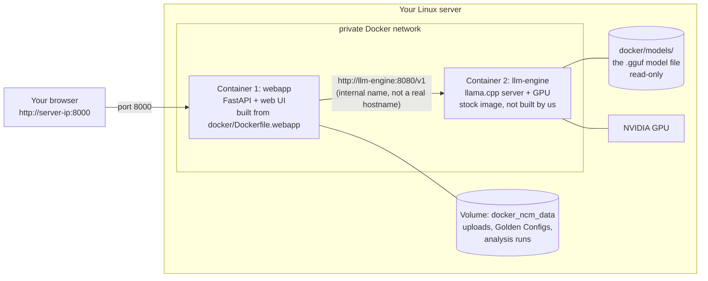

# Docker Deployment Guide

**Who this is for:** anyone deploying NCM Copilot to a Linux server, including
people who have never used Docker. Every command below says what it does,
what you should see, and what to do when it doesn't work. You do not need to
understand Docker before starting — Part 0 explains it.

**How to use this guide:** do the parts in order. Don't skip Part 1 — about
half of all deployment failures are a prerequisite that was never installed,
and they're much harder to diagnose later.

| Part | What it covers |
|---|---|
| [0](#part-0--what-you-are-about-to-do) | What Docker is and what this changes on your server |
| [1](#part-1--before-you-begin) | Prerequisites (one-time server setup) |
| [2](#part-2--install-and-start) | Installing and starting NCM Copilot |
| [3](#part-3--verify-it-works) | Confirming it actually works |
| [4](#part-4--troubleshooting) | When something goes wrong |
| [5](#part-5--day-2-operations) | Updating, restarting, backing up |
| [6](#part-6--uninstall-or-start-over) | Removing everything |
| [A](#appendix-a--glossary) · [B](#appendix-b--offline--air-gapped-install) · [C](#appendix-c--known-gotchas) | Glossary, offline install, gotchas |

---

# Part 0 — What you are about to do

## 0.1 The idea in one paragraph

NCM Copilot normally runs as Python processes you start by hand on a machine
where you've installed Python, the right libraries, an NVIDIA driver, and a
local LLM server. Getting all of that right on someone else's server is slow
and error-prone. Docker solves this by shipping the app **and everything it
needs to run** as a pre-built package. You install Docker once, run one
command, and the app runs the same way it did on the machine where it was
built.

## 0.2 The four words you need

| Word | What it means here |
|---|---|
| **Image** | A read-only template — the app plus its Python version, libraries, and OS packages, frozen together. Like an ISO file. You don't run an image; you run a container from it. |
| **Container** | A running copy of an image. Isolated from your server: its own filesystem and processes. Deleting a container does not affect your server. |
| **Volume** | A storage area Docker manages, which **survives** containers being deleted and rebuilt. Your uploaded configs and analysis results live here. This is the only part that holds data you care about. |
| **Compose** | The tool that starts several containers together with the right settings, reading `docker-compose.yml`. `docker compose up` is the one command that runs everything. |

## 0.3 What actually runs

This deployment is **two containers** that talk to each other on a private
network Docker creates:



- **webapp** — the NCM Copilot web interface and API. This is the only
  container your browser talks to.
- **llm-engine** — the stock `ghcr.io/ggml-org/llama.cpp:server-cuda` image
  running one AI model on the GPU. Used only by the Briefings screen and
  optional Compliance Report polish. **Everything else in the app works
  without it.**

The two find each other by service name (`llm-engine`), which only exists
inside Docker's private network. You never configure IP addresses.

## 0.4 What this changes on your server

Be clear-eyed about this before you run anything:

**It does change:**
- Installs the Docker Engine (a background service that starts at boot).
- Downloads roughly **22 GB of images** — ~15 GB for the webapp image, ~7 GB
  for the CUDA-enabled llama.cpp image. Plus the model file (2.5 GB or 4.7 GB).
- Creates a Docker volume holding your uploaded configs and analysis results.
- Opens **one** port (8000 by default) for the browser UI.
- Both containers are set to `restart: unless-stopped`, so they **start
  automatically when the server reboots** and restart themselves if they crash.

**It does not change:**
- Your system Python, or any system packages beyond Docker itself.
- Anything in the NCM Copilot source checkout — containers never write there.
- Any other port or service on the machine.

**Disk space:** budget **30 GB free** before you start. Check with `df -h /`.
Running out of disk mid-build is a common and confusing failure.

**Time:** 10–20 minutes of prerequisites, then 10–30 minutes for the first
build and download depending on your connection. Later starts take seconds.

---

# Part 1 — Before you begin

Do these once per server. After each step there's a check — **do not continue
past a failed check**, because every later error becomes much harder to read.

## 1.1 Confirm you have a supported machine

```bash
cat /etc/os-release | head -2
nvidia-smi
df -h /
```

You need: a Linux server, an NVIDIA GPU visible to `nvidia-smi`, and ~30 GB
free disk.

**What good looks like:** `nvidia-smi` prints a table with your GPU name,
driver version, and memory.

**If `nvidia-smi` is "command not found"** the NVIDIA driver isn't installed.
Install it through your distribution's normal driver channel (on Ubuntu:
`sudo ubuntu-drivers install`, then reboot) and come back. This guide can't
cover every distro's driver setup, and nothing below works without it.

**VRAM matters.** Check the `Memory` column. The default model (Phi-4-mini,
~2.5 GB) fits comfortably in 6 GB. The larger Qwen model (~4.7 GB) needs more
headroom — on a 6 GB card it will be tight or fail to load.

## 1.2 Install Docker

```bash
curl -fsSL https://get.docker.com | sh
sudo systemctl enable --now docker
```

**What this does:** installs the Docker Engine and sets it to start at boot.
`enable --now` both enables it for future boots and starts it immediately.

**Check:**

```bash
docker compose version
```

**What good looks like:** `Docker Compose version v2.x.x` or higher.

**If you get "docker: command not found"** the install script failed — scroll
up in its output for the real reason (usually an unsupported distro).

**If you get "docker-compose: command not found"** but `docker` works, you're
following an older guide somewhere. This project needs the *plugin* form
(`docker compose`, a space, no hyphen), which `get.docker.com` installs.

## 1.3 Let Docker use the GPU

Docker cannot see your GPU by default. The NVIDIA Container Toolkit is the
bridge:

```bash
curl -fsSL https://nvidia.github.io/libnvidia-container/gpgkey | \
  sudo gpg --dearmor -o /usr/share/keyrings/nvidia-container-toolkit-keyring.gpg
curl -s -L https://nvidia.github.io/libnvidia-container/stable/deb/nvidia-container-toolkit.list | \
  sed 's#deb https://#deb [signed-by=/usr/share/keyrings/nvidia-container-toolkit-keyring.gpg] https://#g' | \
  sudo tee /etc/apt/sources.list.d/nvidia-container-toolkit.list

sudo apt-get update
sudo apt-get install -y nvidia-container-toolkit
sudo nvidia-ctk runtime configure --runtime=docker
sudo systemctl restart docker
```

(Those commands are Debian/Ubuntu. For RHEL/Fedora use NVIDIA's `dnf`
instructions — the `nvidia-ctk` and `systemctl restart` steps are the same.)

**What this does:** adds NVIDIA's package repository, installs the toolkit,
registers it with Docker, and restarts Docker so the change takes effect.

## 1.4 Prove GPU passthrough works

**This is the most valuable check in the guide.** It separates "the GPU
plumbing is broken" from "the app is broken" — two problems that produce
similar-looking failures later.

```bash
docker run --rm --gpus all nvidia/cuda:12.4.0-base-ubuntu22.04 nvidia-smi
```

**What this does:** downloads a tiny test image, runs `nvidia-smi` *inside a
container*, then deletes the container (`--rm`). It touches nothing else.

**What good looks like:** the same GPU table you saw in step 1.1, but printed
from inside the container.

**If it fails:** stop here and fix it. See
[4.6 GPU errors](#46-gpu-not-available-inside-the-container). Do not continue
— nothing below will work.

---

# Part 2 — Install and start

## 2.1 Get the code

```bash
git clone https://github.com/rafa-acosta/ncm_copilot.git
cd ncm_copilot/docker
```

**Every command from here on is run from inside that `docker/` directory.**
This matters: `docker compose` looks for `docker-compose.yml` in your current
directory, and will say `no configuration file provided` if you're elsewhere.

## 2.2 Create your `.env` file

```bash
cp .env.example .env
```

**What this does:** `.env` holds the settings Compose plugs into
`docker-compose.yml` — which model to load, GPU layers, and the web port. The
repo ships `.env.example` as a template; `.env` itself is deliberately *not*
in Git, because it's per-deployment.

**The defaults are correct for most deployments.** You only need to edit
`.env` if you want to change the model or the port:

| Setting | Default | What it does |
|---|---|---|
| `LLM_MODEL_FILE` | `phi-4-mini-instruct-q4_k_m.gguf` | Which file in `docker/models/` the engine loads. Must match the filename exactly. |
| `LLM_MODEL_NAME` | `phi-4-mini-instruct-q4_k_m` | The label shown in the UI and in briefing metadata. Change it together with `LLM_MODEL_FILE`. |
| `LLM_CTX_SIZE` | `2048` | How much text the model can consider at once. |
| `LLM_NGL` | `99` | How many model layers to put on the GPU. `99` means "all of them". |
| `LLM_PARALLEL` | `1` | Concurrent requests. |
| `LLM_CACHE_RAM` | `0` | Disables a cache that caused real memory growth on this project — see `local-llm/README.md`. Leave it at `0`. |
| `WEBAPP_PORT` | `8000` | The port your browser connects to. Change it if 8000 is already used. |

> **Do not skip this step.** It is the single most common deployment failure.
> Compose does not stop when `.env` is missing — it substitutes empty strings
> and starts containers that crash in a loop. See
> [4.3](#43-containers-keep-restarting--env-is-missing) for exactly what that
> looks like.

**Check:**

```bash
docker compose config | head -20
```

**What good looks like:** YAML with real values — `-m /models/phi-4-mini-instruct-q4_k_m.gguf`,
`-ngl "99"`, and **no warnings above it**.

**If you see** `WARN[0000] The "LLM_MODEL_FILE" variable is not set` — your
`.env` wasn't created, or you're in the wrong directory.

## 2.3 Put the model file in place

The AI model is a multi-GB file that is deliberately **not** in Git. You have
to supply it.

**If you already ran the bare-metal setup on this machine,** you already have
the file — just copy it:

```bash
cp ../local-llm/models/phi-4-mini-instruct-q4_k_m.gguf models/
```

**Otherwise download it** (needs `huggingface_hub`: `pip install huggingface_hub`):

```bash
hf download unsloth/Phi-4-mini-instruct-GGUF Phi-4-mini-instruct-Q4_K_M.gguf \
  --local-dir models
mv models/Phi-4-mini-instruct-Q4_K_M.gguf models/phi-4-mini-instruct-q4_k_m.gguf
```

**The rename matters.** The download arrives with capital letters; the
filename must match `LLM_MODEL_FILE` in `.env` *exactly*, including case.

For the larger Qwen model instead, download
`qwen2.5-coder-7b-instruct-q4_k_m.gguf` from
`Qwen/Qwen2.5-Coder-7B-Instruct-GGUF` and update **both** `LLM_MODEL_FILE`
and `LLM_MODEL_NAME` in `.env`.

**Check:**

```bash
ls -lh models/
```

**What good looks like:** your `.gguf` file at roughly 2.5 GB (Phi-4-mini) or
4.7 GB (Qwen). A file of a few hundred bytes means the download failed and
saved an error page instead.

## 2.4 Start everything

```bash
docker compose up --build -d
```

**What this does, in order:**
1. Downloads the stock `llama.cpp` image (~7 GB, first run only).
2. Builds the webapp image from your checkout (~15 GB, first run only) —
   installs Python dependencies and WeasyPrint's PDF libraries.
3. Creates the private network and the `docker_ncm_data` volume.
4. Starts both containers in the background.

**What the flags mean:**
- `--build` rebuilds the webapp image from your current source. Needed the
  first time and after any `git pull`.
- `-d` means "detached" — runs in the background and gives you your prompt
  back. Without it, your terminal stays attached to the logs and **Ctrl-C
  stops the containers**.

**This takes 10–30 minutes the first time.** Later runs take seconds because
the images are cached. It's normal for the output to sit on one line for
minutes during the pip install.

## 2.5 Watch it come up

```bash
docker compose logs -f
```

(`-f` = "follow", a live tail. Press **Ctrl-C** to stop watching — this only
stops the log view, **not** the containers.)

**What good looks like:**

- From `llm-engine`, within a minute or two:
  ```
  srv    load_model: loading model '/models/phi-4-mini-instruct-q4_k_m.gguf'
  srv  llama_server: model loaded
  srv  llama_server: listening on http://0.0.0.0:8080
  ```
- From `webapp`, almost immediately:
  ```
  Uvicorn running on http://0.0.0.0:8000
  ```

**The webapp starts before the model finishes loading.** That's expected —
Compose waits only for the engine container to *start*, not to become ready.
The Settings page may show the LLM as Offline for the first minute. It turns
Online on its own.

**Then confirm both are stably up:**

```bash
docker compose ps
```

**What good looks like:** `STATUS` reads `Up X minutes` for both.

**If `STATUS` says `Restarting`,** something is wrong — go to
[Part 4](#part-4--troubleshooting).

---

# Part 3 — Verify it works

Three checks, in increasing strength. Do all three — the first two can pass
while the deployment is still subtly broken.

**1. The UI loads.** Open `http://<server-ip>:8000` (use the `WEBAPP_PORT`
you set). You should see the NCM Copilot Overview screen.

**2. The engine is reachable.** Go to **Settings**. The backend should show
**Online**, with no Start/Stop buttons and a "started outside this app" note.

> That note is **correct and expected**, not a bug. In Docker the LLM runs as
> its own container managed by Compose, not as a process the webapp spawns —
> so the webapp honestly reports that it can see the engine but doesn't
> control it. To change models here you edit `.env` and recreate the
> container (see [5.2](#52-changing-the-model)), which is the Docker
> equivalent of the Start/Stop buttons.

**3. A real request completes end to end.** Reachability only proves the
network path. To prove the whole stack:

1. **Configuration Files** → upload a device config `.txt`.
2. **Analysis** → run it against the Default Golden Config.
3. **Briefings** → generate a briefing for that device.

If the briefing comes back with text, the webapp container reached the
llm-engine container, the GPU served a real inference, and the result was
written to the volume. That's the whole system working.

---

# Part 4 — Troubleshooting

## 4.1 The four commands that diagnose almost everything

Run these from the `docker/` directory, in this order. **Always start with
the logs** — the answer is in them far more often than not.

```bash
docker compose ps                  # 1. Is it running, restarting, or stopped?
docker compose logs --tail 50      # 2. What did it say before it died?
docker compose logs llm-engine     # 3. Narrow to one container
docker compose config              # 4. Did my settings resolve correctly?
```

**How to read `docker compose ps`:**

| STATUS | Meaning |
|---|---|
| `Up 5 minutes` | Healthy. |
| `Restarting (1)` | Crashing on startup and auto-retrying forever. **Read the logs** — the real error is there. |
| `Exited (0)` | Stopped cleanly, not running. |
| *(not listed)* | Never started, or you're in the wrong directory. |

> **Why "Restarting" instead of a clean error?** Both services use
> `restart: unless-stopped`, so Docker restarts them after any crash. That's
> what you want in production (survives reboots and transient faults), but it
> means a misconfiguration shows up as an endless loop rather than a single
> clear failure. The logs still contain the original error, repeated.

## 4.2 Nothing happens / "no configuration file provided"

**You're in the wrong directory.** `cd` into the `docker/` folder of the
checkout. Confirm with `ls docker-compose.yml`.

## 4.3 Containers keep restarting — `.env` is missing

**Symptom.** `docker compose up` prints a stack of warnings:

```
WARN[0000] The "LLM_MODEL_FILE" variable is not set. Defaulting to a blank string.
WARN[0000] The "LLM_NGL" variable is not set. Defaulting to a blank string.
WARN[0000] The "LLM_CTX_SIZE" variable is not set. Defaulting to a blank string.
...
```

and `docker compose ps` shows both containers `Restarting (1)`.

**In the logs** you'll see, from `llm-engine`:

```
error while handling argument "-ngl": stoi
```

and from `webapp`:

```
docker/entrypoint.sh: line 11: LLM_MODEL_NAME: LLM_MODEL_NAME must be set - see docker/.env.example
```

**What it means.** With no `.env`, Compose replaced every setting with an
empty string. The engine got `-ngl` with no number after it (`stoi` is the
C++ "string to integer" conversion failing on an empty string), and the
webapp's entrypoint refused to start without a model name.

**Fix:**

```bash
cp .env.example .env
docker compose up -d
```

**Those warnings are the real error.** Compose treats missing variables as a
warning, not a failure, so it happily starts containers that cannot work.
Never ignore them.

## 4.4 Containers keep restarting — model file missing or misnamed

**Symptom.** `llm-engine` is `Restarting`, and `docker compose logs llm-engine`
shows:

```
E gguf_init_from_file: failed to open GGUF file '/models/phi-4-mini-instruct-q4_k_m.gguf' (No such file or directory)
E llama_model_load: error loading model: llama_model_loader: failed to load model
E srv  llama_server: exiting due to model loading error
```

**What it means.** The engine looked for the file named in `LLM_MODEL_FILE`
inside `docker/models/` and didn't find it. Three possible causes:

1. The model was never downloaded (`ls -lh models/` shows only `.gitkeep`).
2. The filename doesn't match `.env` exactly — **case-sensitive**.
   `Phi-4-mini-instruct-Q4_K_M.gguf` ≠ `phi-4-mini-instruct-q4_k_m.gguf`.
3. The download failed and left a tiny error-page file behind.

**Fix:** compare the two directly, then correct whichever is wrong:

```bash
ls -lh models/
grep LLM_MODEL_FILE .env
docker compose up -d        # no --build needed; only config changed
```

## 4.5 "Port is already allocated"

**Symptom:** `Bind for 0.0.0.0:8000 failed: port is already allocated`.

**What it means:** something else on the server already uses that port.

**Find it, then pick another port:**

```bash
sudo ss -ltnp | grep ':8000'
```

Edit `WEBAPP_PORT=8080` in `.env`, then `docker compose up -d`. The app now
answers on `http://<server-ip>:8080`. Only the left side of the mapping
changes — inside the container it's always 8000.

## 4.6 GPU not available inside the container

**Symptom:** `could not select device driver "nvidia" with capabilities: [[gpu]]`,
or the engine starts but runs on CPU (very slow briefings).

**Diagnose in this order** — each step rules out one layer:

```bash
nvidia-smi                                 # 1. Does the HOST see the GPU?
docker run --rm --gpus all \
  nvidia/cuda:12.4.0-base-ubuntu22.04 nvidia-smi   # 2. Does a CONTAINER see it?
```

| Result | Meaning | Fix |
|---|---|---|
| 1 fails | Driver problem — nothing to do with Docker | Install/repair the NVIDIA driver, reboot |
| 1 works, 2 fails | Container Toolkit missing or not registered | Redo [1.3](#13-let-docker-use-the-gpu), especially `nvidia-ctk runtime configure` + `systemctl restart docker` |
| Both work, app doesn't | Config problem, not GPU | Check `LLM_NGL` is set — see [4.3](#43-containers-keep-restarting--env-is-missing) |

## 4.7 Settings shows the LLM as Offline

**First: wait a minute.** On a cold start the model takes 30–90 seconds to
load, and the page polls on its own.

**Still offline?**

```bash
docker compose ps                      # is llm-engine Up or Restarting?
docker compose logs --tail 30 llm-engine
```

- `Restarting` → see [4.3](#43-containers-keep-restarting--env-is-missing)
  or [4.4](#44-containers-keep-restarting--model-file-missing-or-misnamed).
- `Up`, and logs show `listening on http://0.0.0.0:8080` → the engine is
  fine and the problem is between the containers. Verify from inside the
  webapp container:

  ```bash
  docker compose exec webapp python3 -c \
    "import httpx; print(httpx.get('http://llm-engine:8080/v1/models', timeout=5).status_code)"
  ```

  `200` means the path works and the UI just needs a refresh. A connection
  error means the containers aren't on the same network — `docker compose
  down && docker compose up -d` recreates it.

## 4.8 Out of disk space

**Symptom:** `no space left on device` during build, or odd write failures.

```bash
df -h /
docker system df        # how much Docker specifically is using
```

**Reclaim safely:**

```bash
docker image prune -a      # removes images not used by any container
docker builder prune       # removes build cache
```

> **Safe:** both commands above leave running containers and **all volumes**
> untouched, so your data survives. You'll just re-download/rebuild images
> next time.
>
> **Dangerous:** `docker system prune --volumes` also deletes volumes — that
> is your NCM Copilot data. Don't use it unless you mean it.

## 4.9 Changes to the code didn't take effect

The webapp image is a **frozen copy** of the source taken at build time.
Editing files in your checkout changes nothing until you rebuild:

```bash
docker compose up -d --build webapp
```

If it still looks stale, force a clean rebuild:

```bash
docker compose build --no-cache webapp && docker compose up -d webapp
```

## 4.10 Getting more detail

```bash
docker compose logs --tail 200 webapp        # more history
docker compose exec webapp bash              # a shell inside the container
docker inspect docker-webapp-1 | less        # full container configuration
docker stats                                 # live CPU/memory per container
```

`docker compose exec webapp bash` is safe and often the fastest way to answer
"is the file actually in there?" — you're inside the container's filesystem.
Type `exit` to leave.

---

# Part 5 — Day-2 operations

## 5.1 Everyday commands

| Task | Command | Destroys data? |
|---|---|---|
| See status | `docker compose ps` | No |
| Watch logs live | `docker compose logs -f` | No |
| Restart both | `docker compose restart` | No |
| Stop (keeps everything) | `docker compose stop` | No |
| Stop and remove containers | `docker compose down` | No — the volume survives |
| Start again | `docker compose up -d` | No |
| **Stop and wipe all data** | `docker compose down -v` | **YES — see 5.4** |

`docker compose restart` restarts the processes but **does not re-read
`.env`**. After editing `.env`, use `docker compose up -d` instead, which
recreates containers with the new values.

## 5.2 Changing the model

```bash
# 1. Make sure the new .gguf is in models/
ls -lh models/

# 2. Edit .env — change BOTH lines together
#    LLM_MODEL_FILE=qwen2.5-coder-7b-instruct-q4_k_m.gguf
#    LLM_MODEL_NAME=qwen2.5-coder-7b-instruct-q4_k_m

# 3. Recreate the engine (and the webapp, which displays the model name)
docker compose up -d
```

Only one model runs at a time — a GPU VRAM limit, the same constraint the
bare-metal setup has. Check your VRAM in `nvidia-smi` before switching to the
larger model.

## 5.3 Updating to a new version

```bash
git pull
docker compose up -d --build
```

Your data is in a volume, not in the checkout, so it survives updates. The
rebuild only re-runs the steps whose inputs changed — usually a minute or two,
not the full first-run build.

## 5.4 Backing up your data

Everything users create — uploaded configs, Golden Config profiles, analysis
runs, compliance history — lives in the Docker volume `docker_ncm_data`, not
in the source checkout. Back it up before anything risky:

```bash
docker run --rm -v docker_ncm_data:/data -v "$PWD":/backup alpine \
  tar czf /backup/ncm-data-backup.tar.gz -C /data .
```

Restore into a fresh volume:

```bash
docker run --rm -v docker_ncm_data:/data -v "$PWD":/backup alpine \
  tar xzf /backup/ncm-data-backup.tar.gz -C /data
```

> **The volume name has a prefix.** Compose names volumes
> `<project>_<volume>`, and the project name comes from the directory —
> so the `ncm_data` volume in `docker-compose.yml` becomes `docker_ncm_data`
> on disk. Confirm yours with `docker volume ls`. See
> [Appendix C](#appendix-c--known-gotchas).

## 5.5 Does it survive a reboot?

Yes. Both services use `restart: unless-stopped`, and Docker itself is
enabled at boot (step 1.2). After a server reboot both containers come back
automatically. Verify with `docker compose ps`.

The one exception is in the name: if you stopped a container **yourself**
with `docker compose stop`, Docker respects that and won't restart it on
boot. Start it again with `docker compose up -d`.

---

# Part 6 — Uninstall or start over

**Remove containers, keep data** (for a clean restart):

```bash
docker compose down
docker compose up -d
```

**Remove containers and all NCM Copilot data** — uploaded configs, Golden
Config profiles, every analysis run:

```bash
docker compose down -v
```

> `-v` deletes the volume. This cannot be undone. Back up first
> ([5.4](#54-backing-up-your-data)) if there's anything you want to keep.

**Also reclaim the ~22 GB of images:**

```bash
docker compose down -v
docker image rm docker-webapp ghcr.io/ggml-org/llama.cpp:server-cuda
```

**Remove Docker itself** (Debian/Ubuntu):

```bash
sudo apt-get purge -y docker-ce docker-ce-cli containerd.io docker-compose-plugin
sudo rm -rf /var/lib/docker
```

`/var/lib/docker` holds every image, container, and volume on the machine —
including any unrelated to this project. Only run that if Docker is here
solely for NCM Copilot.

---

# Appendix A — Glossary

| Term | Meaning |
|---|---|
| **Image** | Frozen template containing the app and its dependencies. |
| **Container** | A running instance of an image. |
| **Volume** | Docker-managed storage that outlives containers. Your data. |
| **Compose** | Tool that runs multi-container setups from `docker-compose.yml`. |
| **Service** | One entry in `docker-compose.yml` (`webapp`, `llm-engine`). |
| **Project** | A group of services, named after the directory by default. |
| **Bind mount** | A host directory mapped into a container (here: `models/`). Unlike a volume, you can see and edit it normally. |
| **`-d` / detached** | Run in the background. |
| **`-f` / follow** | Live-tail the logs; Ctrl-C stops watching, not the app. |
| **GGUF** | The model file format llama.cpp loads. |
| **VRAM** | GPU memory. Determines which model fits. |
| **Entrypoint** | The command a container runs at start — here `docker/entrypoint.sh`. |

---

# Appendix B — Offline / air-gapped install

If the target server has no internet, build on a connected machine and carry
the result over.

**On a machine with internet,** from `docker/`:

```bash
docker compose build
docker pull ghcr.io/ggml-org/llama.cpp:server-cuda
docker save docker-webapp ghcr.io/ggml-org/llama.cpp:server-cuda \
  -o ncm-copilot-images.tar      # ~22 GB
```

**Transfer** `ncm-copilot-images.tar`, the repo checkout, and your `.gguf`
model file to the target server.

**On the target server:**

```bash
docker load -i ncm-copilot-images.tar
cd ncm_copilot/docker
cp .env.example .env
cp /path/to/your/model.gguf models/
docker compose up -d          # no --build — images are already loaded
```

The Docker and NVIDIA Container Toolkit installs in [Part 1](#part-1--before-you-begin)
still need your environment's normal offline package mirror; that part isn't
specific to this project.

---

# Appendix C — Known gotchas

## C.1 Two checkouts both named `docker/` collide

Compose derives the **project name** from the directory it runs in. Both
`~/ncm_copilot/docker/` and `~/ncm_copilot_customer_test/docker/` are named
`docker`, so Compose treats them as **the same project** — meaning
`docker compose ps` run in one checkout lists and controls containers started
from the other, and both share the `docker_ncm_data` volume.

**How to tell which checkout a container actually came from:**

```bash
docker inspect docker-webapp-1 \
  --format '{{index .Config.Labels "com.docker.compose.project.working_dir"}}'
```

**To keep two deployments separate,** give each an explicit project name:

```bash
docker compose -p ncm-prod up -d        # instead of the default
```

Be aware that changing the project name changes the volume name too
(`ncm-prod_ncm_data`), so an existing deployment will look like it lost its
data. Back up first ([5.4](#54-backing-up-your-data)) if you switch.

## C.2 `.env` is not in Git, on purpose

`docker/.env` is listed in `.gitignore` — it's per-deployment. `git pull`
never creates or updates it. After cloning, you always run
`cp .env.example .env` yourself.

## C.3 Editing source files doesn't change a running container

The image is a snapshot taken at build time. Rebuild with
`docker compose up -d --build` — see [4.9](#49-changes-to-the-code-didnt-take-effect).

## C.4 `restart: unless-stopped` masks crashes as loops

A fatal misconfiguration appears as a container restarting forever rather
than failing once with a clear message. `docker compose ps` showing
`Restarting` always means "read the logs" — see
[4.1](#41-the-four-commands-that-diagnose-almost-everything).
